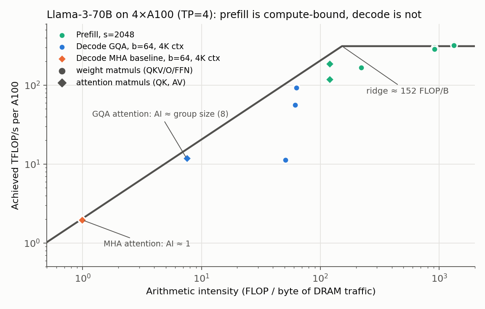
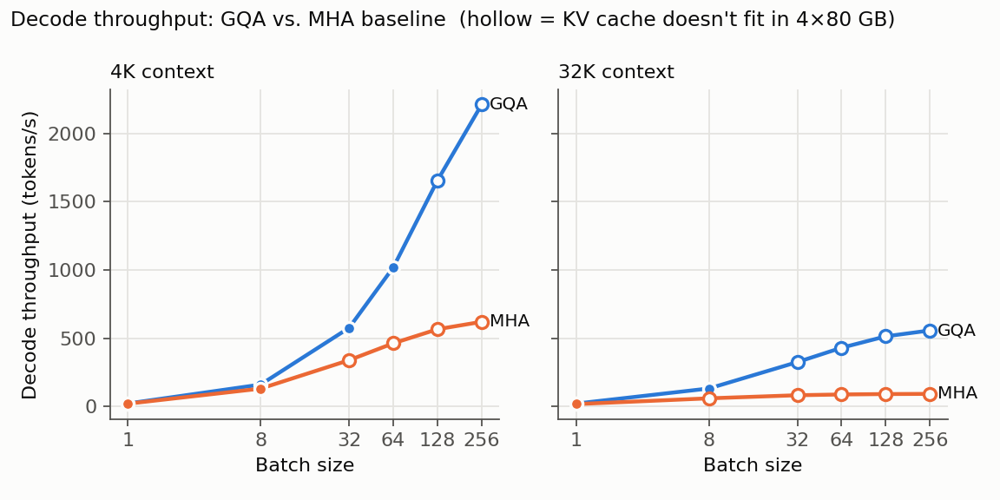
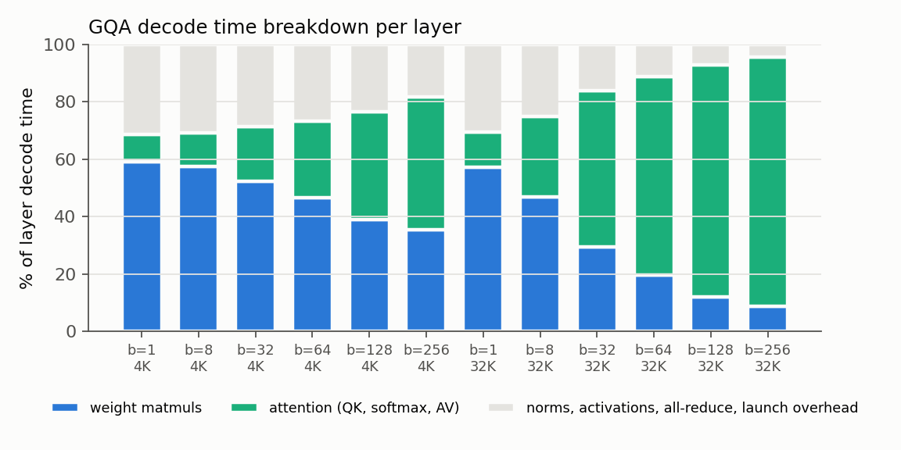
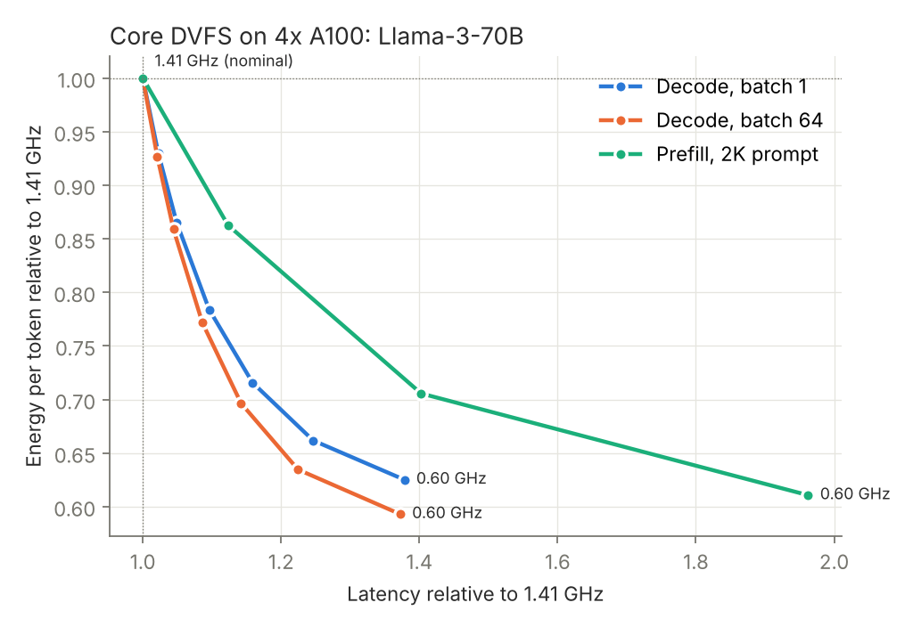
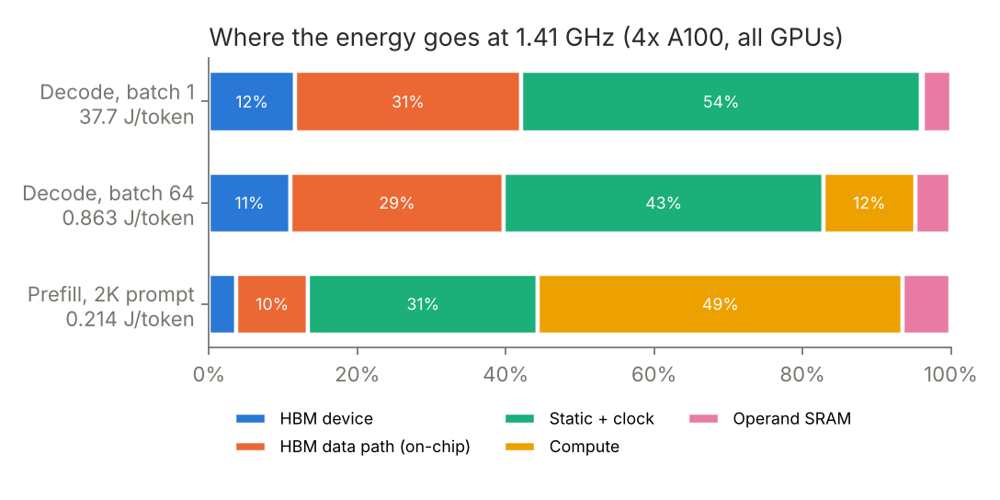

# Llama-3-70B inference on systolic-array accelerators: GQA, the memory wall, and energy under DVFS

An extension of [LLMCompass](https://github.com/PrincetonUniversity/LLMCompass) (Zhang et al., ISCA 2024),
a validated hardware simulator for LLM inference. Upstream LLMCompass models GPT-3 (multi-head attention,
GeLU FFN). This fork adds a **Llama-3-style decoder layer**: grouped-query attention (GQA), SwiGLU FFN
and RMSNorm. It uses the fork to answer one question:

> **On a 4×A100 node serving Llama-3-70B, what actually limits decode throughput, how much of the
> answer is GQA, and what does lowering the core clock buy in energy per token?**

- **v0.1:** Llama-3 decoder (GQA, SwiGLU, RMSNorm), decode/prefill sweeps, and a validation against
  published TensorRT-LLM A100 measurements (13% mean absolute error).
- **v0.2:** a per-component energy model with core DVFS, checked against published A100
  power-capping measurements (3.1 percentage-point mean error after a one-parameter fit).

Everything below comes from LLMCompass's tile-level simulator (systolic-array cycle counts from SCALE-Sim,
L2/DRAM tiling, NVLink all-reduce). It uses public model configs, public hardware specs and published measurements only.

## Key findings

Setup: Llama-3-70B, FP16, tensor parallel = 4 on 4× A100-80GB (LLMCompass `GA100` config:
312 TFLOP/s and 2.05 TB/s HBM per GPU, so the ridge point is 152 FLOP/byte).

1. **Decode is memory-bound, not compute-bound.** At 4K context, going from batch 1 to batch 64 raises
   per-token latency by only 29% (48.5 → 62.8 ms) while throughput rises 48× (21 → 1,019 tokens/s).
   Weight matmuls run at arithmetic intensity ≈ batch size, far left of the 152 FLOP/B ridge.
   Prefill sits at or near the compute roof (TTFT: 100 ms for 512 tokens, 323 ms for 2K, 1.57 s for 8K).
2. **Attention is memory-bound at every batch size.** Batching does not help it: attention's arithmetic
   intensity equals the GQA group size (8, or 1 for MHA), whatever the batch. At 32K context, attention
   is 28% of layer time at batch 8 and 54% at batch 32 (past the memory limit), overtaking the weight matmuls.
3. **GQA's biggest win is capacity, not bandwidth.** At the same batch, GQA is about 2.2× faster than an
   MHA version of the same model (4K, b=64: 1,019 vs 462 tokens/s). But the KV cache shrinks 8×
   (320 KB vs 2.5 MB per token), so after the 35 GB/GPU of weights, GQA fits batch ~121 at 4K (MHA: ~15)
   and batch ~15 at 32K (MHA: 1). **Comparing the largest batch that fits, GQA serves about 8× more
   tokens/s** (4K: 1,019 vs 130; 32K: 131 vs 16).
4. **Long context turns into a KV-cache-bandwidth problem.** At 32K context, GQA throughput flattens
   around ~500 tokens/s even with unlimited memory. Past that point, faster HBM or smaller KV (FP8 KV,
   MLA, sliding window) matters more than more FLOPs.
5. **Fixed per-kernel overheads matter at small batch.** At batch 1, norms, activations, all-reduce and
   kernel-launch overhead are about 30% of layer time. Largely because of them, simulated decode latency at 4K
   context is 20–30% above the pure roofline.





Raw numbers: [`myexp/results/`](myexp/results/) (`decode_sweep.csv`, `prefill_sweep.csv`, `op_stats.csv`).

## Validation against published hardware measurements

The simulator was compared with NVIDIA's published TensorRT-LLM v0.5.0 numbers for Llama-70B on A100
(FP16, tensor parallel 4): [performance.md](https://github.com/NVIDIA/TensorRT-LLM/blob/release/0.5.0/docs/source/performance.md).
That release benchmarked Llama-2-70B, which has the same layer shapes as Llama-3-70B (GQA with 8 KV
heads, FFN 28672) and a smaller vocabulary, so the check simulates Llama-2-70B. Throughput is
reproduced the way TensorRT-LLM's benchmark counts it: batch × output tokens divided by the whole
request time, prefill included. Nothing was tuned to these numbers.

| Metric | Published | Simulated | Error |
|---|---:|---:|---:|
| TTFT, batch 1, 128-token prompt (ms) | 47 | 52.7 | +12.0% |
| TTFT, batch 1, 2048-token prompt (ms) | 377 | 322.6 | −14.4% |
| Throughput, batch 64, 128 in / 128 out (tok/s) | 1,237 | 1,081 | −12.6% |
| Throughput, batch 64, 128 in / 2048 out (tok/s) | 1,181 | 1,179 | −0.2% |
| Throughput, batch 64, 2048 in / 128 out (tok/s) | 272 | 313 | +15.0% |
| Throughput, batch 64, 2048 in / 2048 out (tok/s) | 738 | 931 | +26.1% |

**Mean absolute error 13.4%, with errors on both sides (no systematic bias).** How to read it:

- Short-context decode matches well (128 in / 2048 out: −0.2%).
- The model gets **more optimistic as context grows**: 2048 in / 2048 out is +26%, while the same
  output length from a 128-token prompt is exact. Most of that gap sits in decode at 2K–4K context,
  so long-context attention is likely costlier on the real system than modeled. A plausible cause is
  KV-cache reads achieving less than full HBM bandwidth. This is a hypothesis, not tested here.
- Prefill is +12% at 128 tokens and −14% at 2K, so prefill scaling with prompt length is off by about
  ±15%.
- Expect roughly ±15% on absolute numbers. Comparisons between configurations run in the same model
  (GQA vs. MHA, batch vs. batch, clock vs. clock) should be more reliable than absolute values.
- Caveats: the reference GPU variant isn't stated beyond "A100", and TensorRT-LLM v0.5 is an older
  software stack. No published A100 batch-1 time per output token was found, so batch-1 decode
  (simulated 48 ms at 2K context) is **not** validated. LLMCompass's fixed per-kernel overhead
  (≈27 ms per decode step, calibrated on eager PyTorch) probably overstates it for CUDA-graph runtimes.

Script: [`myexp/validate_published.py`](myexp/validate_published.py). Results: `myexp/results/validation.{md,csv}`.

## v0.2: Energy per token under core DVFS

**Question:** decode is memory-bound, so in principle the core clock can drop with little latency
cost. How much energy per token does that actually save, and how does it compare with prefill?

### Model

Per device, over a simulated interval at core clock *f* and core voltage *V(f)*:

```
E = MACs·e_mac·v² + vecFLOPs·e_vec·v² + operandSRAM_bytes·e_l2·v²        (core domain)
  + HBM_bytes·e_path·v²                                                  (HBM-side on-chip data path)
  + HBM_bytes·e_hbm + NVLink_bytes·e_link                                (fixed-voltage I/O)
  + [P_leak·v³ + P_clk·(f/f0)·v² + P_fixed]·latency                      (time-proportional)
```

where v = V/V0. Latency comes from rerunning LLMCompass at clock *f*: compute cycles stretch and HBM
time doesn't. Event counts are computed analytically from the same operator graph, and they match the
simulator's own byte accounting to 0.1%.

| Parameter | Value | Source |
|---|---|---|
| e_hbm | 31.2 pJ/B (3.9 pJ/bit) | O'Connor et al., MICRO 2017 |
| e_mac | 1.47 pJ per FP16 MAC incl. operand delivery | Calibrated so an 8192³ GEMM at 1.41 GHz draws the 400 W A100 TDP |
| e_path | 82 pJ/B per HBM byte | **Fitted** (see check below) |
| V–f curve | linear, 0.65·V0 at 0.6 GHz → V0 at 1.41 GHz | Generic 7 nm-class assumption, **no vendor data** |
| P_leak, P_clk, P_fixed, e_vec, e_l2 (operand SRAM), e_link | 40 W, 30 W, 35 W, 2 pJ, 5 pJ/B, 10 pJ/B | Order-of-magnitude assumptions |

### Checking it against measured data, and what that changed

Reference: Samsi et al., [*From Words to Watts*](https://arxiv.org/abs/2310.03003) (IEEE HPEC 2023),
Table III. They ran LLaMA-65B on 4× A100-80GB at batch 64 and lowered the power cap from 250 W:
175 W cost +6.7% time for −23.2% energy, and 150 W cost +19.5% time for −34.0% energy. The
175 W row implies the uncapped run drew about **243 W per GPU**.

The model as first built **failed this check**:

1. **Decode power was too low.** It predicted 172 W per GPU, so a 175 W cap would never bind, but the
   measurement implies 243 W. One parameter fixes the level: energy per byte on the on-chip path between
   HBM and the SMs (memory controller, crossbar, L2 fill, load path). Fitting it to the implied 243 W
   gives 82 pJ/B (≈10 pJ/bit on top of HBM's 3.9). That's large, but it says the same thing the
   architecture literature does: moving the bytes on-chip costs more than reading them from DRAM.
   It's a lumped, fitted term, not a measurement.
2. **Latency barely responded to the clock.** Even at 0.6 GHz the model slowed decode by 5%; the
   measurement shows +19.5% at 150 W. LLMCompass treats per-kernel overhead
   as clock-independent CPU launch latency (≈27 ms, about 47% of a batch-64 decode step). If part of it is GPU-side work that stretches with 1/f,
   the sensitivity appears.

| Scenario | 175 W: time / energy (measured +6.7% / −23.2%) | 150 W: time / energy (measured +19.5% / −34.0%) | Mean error |
|---|---:|---:|---:|
| A: as first built | +0.0% / +0.0% | +0.2% / −12.6% | 17.6 pp |
| C, α = 0 (fitted e_path only) | +0.5% / −27.6% | +1.2% / −37.6% | 8.1 pp |
| **C, α = 0.5 (half of the overhead clock-bound)** | **+8.2% / −22.2%** | **+13.7% / −29.9%** | **3.1 pp** |
| C, α = 1 | +14.1% / −18.0% | +23.2% / −24.3% | 6.5 pp |

α = 0.5 is the calibrated model used below. Honest caveats: e_path is fitted to the implied baseline
power from the same paper. The four deltas aren't fitted, but choosing α among {0, 0.5, 1} did look at
them. LLaMA-65B (MHA) at batch 64 is close to, but not the same as, the Llama-3-70B workloads below. The paper's
A100s are listed at 300 W TDP (PCIe-class boards), while this model is calibrated as the 400 W SXM part.
It's the same GA100 die and 1.41 GHz boost, and the comparison uses relative changes, but absolute
watts shouldn't be read across. Their software (eager PyTorch) is also slower per token than modern
serving stacks.
Full table: `myexp/results/powercap_check.md`.

### Findings (calibrated model, Llama-3-70B, 4× A100, energy summed over all four GPUs)

1. **Decode trades energy for latency at about 3:1 near nominal clock.** Batch 64 at 2K context:
   1.20 GHz costs **+4.4% latency for −14.1% energy per token**, and 1.05 GHz costs +8.6% for −22.8%.
   Batch 1 behaves almost the same (+4.9% / −13.5% at 1.20 GHz).
2. **Prefill trades about 1:1.** A 2K prompt at 1.20 GHz costs +12.3% time-to-first-token for −13.7%
   energy. Prefill is compute-bound, so clock cuts show up directly in latency.
3. **So the clock should follow the phase.** Run prefill at full clock and decode lower. On
   disaggregated serving (separate prefill and decode GPUs, as in Splitwise or DistServe) that's a
   static per-pool setting. On a mixed GPU it needs per-phase DVFS fast enough to switch between
   batches.
4. **Decode energy is mostly data movement plus static power, not math.** At 1.41 GHz, batch-64 decode
   splits into 43% static and clock, 40% HBM plus the on-chip data path, and 12% compute (0.86 J per
   token). Batch 1 is 44× worse per token (37.7 J), because the same weight traffic and static power
   are spread over one token. Batching is still the biggest energy lever by far; DVFS is the next 15–25%.
5. **The first model would have overclaimed.** As built, it said decode could drop to 0.6 GHz for −43%
   energy at +5% latency, essentially free. Measured data says the real trade is a lot less generous.
   That's why the check matters.




Limitations specific to v0.2: the V–f curve and several power terms are assumptions (results move
with them, and the README doesn't claim otherwise). HBM and NVLink clocks are held fixed. There's no
thermal model and no clock-switching latency. Power-cap emulation assumes the cap maps to a single
steady clock. Energy is GPU-only: no CPU, network or cooling.

## What I added

| File | What it is |
|---|---|
| [`software_model/llama.py`](software_model/llama.py) | `LlamaDecoderLayerTP`: GQA attention modeled as a batched matmul `[b·n_kv, g·s, d_h] × [b·n_kv, d_h, s_kv]`, so the query group becomes the matmul M dimension; SwiGLU FFN; RMSNorm; TP all-reduces; per-op FLOP/byte accounting. `LMHeadTP` for the vocab projection. `LlamaConfig` with public Llama-3-70B parameters and an MHA counterfactual. |
| [`myexp/validate_llama.py`](myexp/validate_llama.py) | Hand-calculation checks: 70.55 B parameters, 320 KB KV cache per token (2·80·8·128·2 B), 34.2 GB weights per GPU at TP=4, attention arithmetic intensity ≈ 8. |
| [`myexp/sweep_llama.py`](myexp/sweep_llama.py) | Decode sweep (batch 1–256 × context 4K/32K × GQA/MHA) and prefill sweep (512–8K), with HBM capacity check. |
| [`myexp/plot_llama.py`](myexp/plot_llama.py) | The three v0.1 figures. |
| [`myexp/validate_published.py`](myexp/validate_published.py) | v0.1 validation against TensorRT-LLM's published A100 Llama-70B numbers. Adds `LLAMA2_70B` config. |
| [`hardware_model/energy_model.py`](hardware_model/energy_model.py) | v0.2 energy model: per-component energies, V–f curve, static/clock/leakage power, analytic event counts per Llama layer, MAC-energy calibration. |
| [`myexp/dvfs_sweep.py`](myexp/dvfs_sweep.py) | Reruns LLMCompass at 0.6–1.41 GHz for four workloads, plus the calibration GEMM. |
| [`myexp/compare_powercap.py`](myexp/compare_powercap.py) | Checks the energy model against published A100 power-capping data; fits e_path; scenario table. |
| [`myexp/energy_report.py`](myexp/energy_report.py), [`myexp/plot_v02.py`](myexp/plot_v02.py) | v0.2 results table (`dvfs_energy.csv`) and figures. |

## Reproduce

```bash
conda create -n llmcompass python=3.11 -y && conda activate llmcompass
pip install torch "scalesim==2.0.2" scipy matplotlib seaborn pandas numpy
python myexp/validate_llama.py      # seconds
python myexp/sweep_llama.py         # ~1 h on 2 cores the first run (cached afterwards)
python myexp/plot_llama.py
python myexp/validate_published.py  # ~1.5 h on 2 cores (cached per point)
python myexp/dvfs_sweep.py          # ~2-3 h on 2 cores (cached per point)
python myexp/compare_powercap.py && python myexp/energy_report.py && python myexp/plot_v02.py
```
PyTorch is only used by LLMCompass's real-GPU benchmarking paths. Simulation runs without a GPU.
`scalesim` must be 2.0.x. Version 3.0 changed its config format and breaks LLMCompass.

## Modeling assumptions and limitations

- **Memory-capacity check:** 80 GB/GPU − FP16 weights/TP − 4 GB reserve for activations and workspace.
  Throughput beyond that line is reported (hollow markers) to show the bandwidth trend, but a real
  server can't run it without offloading or KV compression.
- No causal-mask savings in prefill. No FlashAttention-style fusion: softmax scores round-trip through
  memory, so long-context attention is somewhat pessimistic.
- SiLU uses LLMCompass's GeLU vector-op cost, and RMSNorm uses LayerNorm's (slightly pessimistic).
  Reshape, transpose and KV-append are not simulated, consistent with upstream.
- No speculative decoding, paged-KV fragmentation or continuous-batching scheduler effects.
- LLMCompass's own validation (upstream paper) reports ~4% average error against real A100s on its
  GPT-3 workloads. The Llama numbers here are within 13% on average of published TensorRT-LLM
  measurements (see Validation above).

## Roadmap

- ~~v0.2: energy model with DVFS~~ (done, above).
- **v0.3:** model achieved KV-cache bandwidth in long-context attention (the largest validation gap),
  and split per-kernel overhead into CPU-launch and GPU-side parts using published profiles instead of
  the single α.
- Disaggregated prefill/decode design-space exploration with per-pool clocks: energy per token
  against TTFT and TPOT targets.

## Credit

Built on LLMCompass by Hengrui Zhang, August Ning, Rohan Baskar Prabhakar and David Wentzlaff
(Princeton): [paper](https://parallel.princeton.edu/papers/isca24_llmcompass.pdf). The original README is in
[`docs/UPSTREAM_README.md`](docs/UPSTREAM_README.md). License: BSD 3-Clause, same as upstream (see [LICENSE](LICENSE)).
